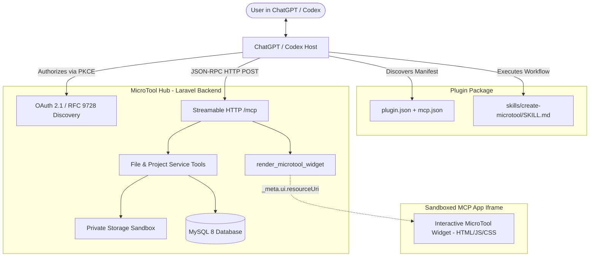

# MicroTool Hub — Laravel Community Platform & ChatGPT MCP Plugin

[](https://php.net)
[](https://laravel.com)
[](https://postgresql.org)
[](https://modelcontextprotocol.io)
[](https://agent-plugins.org)

**MicroTool Hub** is a full-featured developer platform where users discover, create, edit, preview, publish, share, and fork small single-purpose web tools (calculators, formatters, converters, generators, mini-games, and visual utilities).

The platform integrates natively with **ChatGPT** and **Codex** via a remote **Model Context Protocol (MCP)** server over Streamable HTTP and the **MCP Apps UI standard**.

---

## Features

- **Multi-Database Support**: Native support for **PostgreSQL 14+** (Neon, Supabase, Render, Railway, AWS RDS), **MySQL 8** (cPanel shared hosting), and **SQLite** (local development & testing). See [POSTGRESQL_SETUP.md](file:///c:/project/microtoolmcp/POSTGRESQL_SETUP.md).
- **AI Code Studio**: 3-panel developer workspace with file tree, real-time code editor, keyboard shortcuts (`Ctrl+S`), autosave indicators, and instant live sandboxed previews.
- **Remote MCP Server (`POST /mcp`)**: Streamable HTTP JSON-RPC 2.0 server exposing 24 tools with strict schemas, decoupled data/render pattern, and mandatory safety annotations.
- **MCP Apps In-Chat Interactive UI**: Renders live, functional micro-tools directly in ChatGPT conversation streams via `render_microtool_widget` (`ui://microtool/preview.html`).
- **OAuth 2.1 & RFC 9728 Discovery**: Full authorization server metadata, PKCE (`S256`), protected resource metadata, and domain verification challenge.
- **Secure Private Filesystem Sandbox**: Absolute containment in `storage/app/private/projects/` preventing directory traversal (`..`, null bytes, symlinks) and restricting file types to safe web assets.
- **Project Version Snapshots**: Instant ZIP snapshots (`create_snapshot`, `restore_snapshot`) before modifications and for version locking on publish.
- **Community Discovery & Forking**: Public catalog with category filters, search, likes, comments, author profiles, and one-click tool forking.
- **cPanel Shared Hosting Ready**: Runs on standard Apache/MySQL 8 without requiring Node.js, Supervisor, or Docker on the production server.

---

## Architecture Overview



---

## Quick Start (Local Development)

### 1. Requirements
- PHP 8.3 or higher (PHP 8.3, 8.4, 8.5)
- Composer 2.x
- SQLite or MySQL 8

### 2. Setup
```bash
git clone https://github.com/example/microtool-hub.git
cd microtool-hub

# Install dependencies
composer install

# Environment configuration
cp .env.example .env
php artisan key:generate

# Database migration & demo seeding
php artisan migrate --seed

# Launch development server
php artisan serve
```

Access the application in your browser at `http://localhost:8000`.

### 3. Default Demo Accounts
- **Creator Account**: `alex@microtoolhub.com` / `password123`
- **Admin Account**: `admin@microtoolhub.com` / `adminpassword123`

---

## MCP Server Tools (All 24 Tools)

| Tool Name | Type | Description | Safety Hints |
| :--- | :---: | :--- | :--- |
| `create_project` | Mutation | Initialize a new micro-tool workspace | `readOnly: false` |
| `list_projects` | Query | List workspaces owned by authenticated user | `readOnly: true` |
| `get_project` | Query | Get workspace details, file counts, and storage | `readOnly: true` |
| `update_project_metadata`| Mutation | Update name, description, category, visibility | `readOnly: false` |
| `delete_project` | Destructive | Delete workspace and all assets | `destructive: true` |
| `list_project_files` | Query | List files and directory tree | `readOnly: true` |
| `read_project_file` | Query | Read raw source code of a file | `readOnly: true` |
| `write_project_file` | Mutation | Save atomic source file (HTML, CSS, JS, etc.) | `readOnly: false` |
| `rename_project_file` | Mutation | Move or rename file | `readOnly: false` |
| `delete_project_file` | Destructive | Remove file from workspace | `destructive: true` |
| `create_project_directory`| Mutation | Create subfolder | `readOnly: false` |
| `validate_project` | Query | Validate index.html, tag balance, and quotas | `readOnly: true` |
| `get_project_status` | Query | Check quota usage and last snapshot | `readOnly: true` |
| `create_snapshot` | Mutation | Create version backup archive (ZIP) | `readOnly: false` |
| `list_snapshots` | Query | List project version history | `readOnly: true` |
| `compare_snapshots` | Query | Diff files between two versions | `readOnly: true` |
| `restore_snapshot` | Destructive | Roll back project to a snapshot | `destructive: true` |
| `preview_project` | Query | Generate sandbox URL | `readOnly: true` |
| `render_microtool_widget`| **Render** | **Renders in-chat MCP Apps interactive widget** | `ui.resourceUri: true` |
| `publish_project` | Mutation | Publish approved tool to community catalog | `readOnly: false` |
| `unpublish_project` | Destructive | Withdraw tool from public catalog | `destructive: true` |
| `fork_project` | Mutation | Clone public tool into user's account | `readOnly: false` |
| `search_tools` | Query | Search community directory | `readOnly: true` |
| `get_tool_details` | Query | Get public metadata and launch URL | `readOnly: true` |

---

## Testing & Validation

Run the complete automated test suite (15 tests, 151 assertions):
```bash
php artisan test
```

Pre-validate the ChatGPT Plugin manifest and packaging:
```bash
python c:/project/chatgptmcpguideskill/scripts/validate_plugin.py .
```

---

## Deployment & Production

Refer to [CPANEL_DEPLOYMENT.md](file:///c:/project/microtoolmcp/CPANEL_DEPLOYMENT.md) for full instructions on setting up cPanel, MySQL 8, HTTPS, and Apache `.htaccess` authorization header rules.
