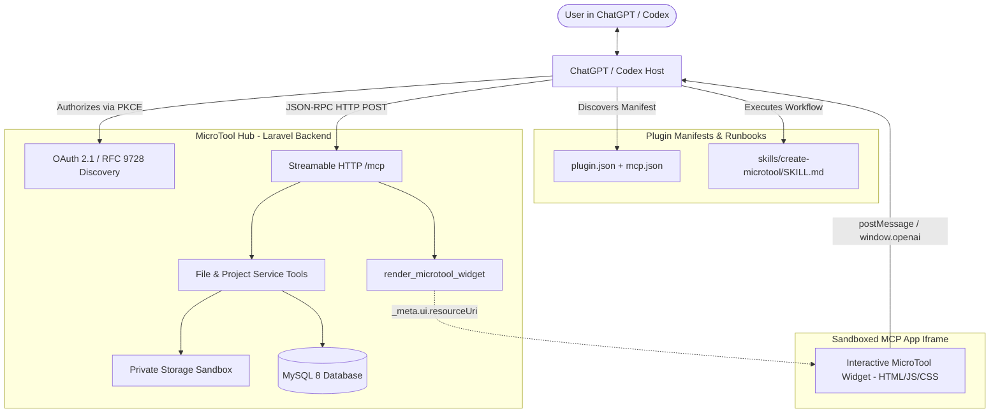

# MASTER DEVELOPMENT SPECIFICATION & IMPLEMENTATION BLUEPRINT
## MicroTool Hub — Laravel Community Platform & ChatGPT/Codex MCP Plugin

---

## 1. Project Overview & Architecture

**MicroTool Hub** is a production-grade web application and developer community where users discover, create, edit, preview, publish, share, and fork small single-purpose web tools (calculators, formatters, converters, generators, mini-games, and visual utilities).

The platform integrates natively with **ChatGPT** and **Codex** as an official **Plugin** built on the open **Model Context Protocol (MCP)** and the **MCP Apps UI Standard**. Authorized AI assistants can orchestrate project creation, write source code, read existing files, run validations, create snapshot backups, render interactive in-chat previews, and publish approved micro-tools directly from conversation streams.

The architecture comprises three synchronized layers:
1. **Laravel Core Web Application & REST/Blade Frontend**: Modern PHP 8.3+ backend running on MySQL 8, providing user management, project storage, private filesystem sandbox, moderation, audit logging, and public community discovery.
2. **Remote MCP Server (Streamable HTTP)**: Standardized JSON-RPC 2.0 endpoint (`POST /mcp`) implementing the Model Context Protocol, secured by OAuth 2.1 (RFC 9728 discovery & PKCE), with mandatory tool safety annotations.
3. **ChatGPT Plugin & MCP Apps In-Chat UI**: Standalone manifest (`plugin.json`, `mcp.json`), repeatable execution runbooks (`skills/*/SKILL.md`), and sandboxed interactive iframe widgets (`ui://microtool/preview.html`) allowing users to interact with live micro-tools directly inside ChatGPT.



---

## 2. Technology Stack & Operational Constraints

- **Backend**: Laravel 11 / 12, PHP 8.3+ (CLI & FPM)
- **Database**: PostgreSQL (Neon, Supabase, Render, AWS RDS, self-hosted), MySQL 8.0+ (cPanel compatible, InnoDB, utf8mb4), and SQLite
- **Frontend**: Blade templates, Bootstrap 5.3+, Vanilla CSS & JavaScript (zero runtime Node.js dependency on server)
- **MCP Server Protocol**: Streamable HTTP (`application/json` & `text/event-stream`), JSON-RPC 2.0
- **MCP UI Standard**: MCP Apps open standard (`text/html;profile=mcp-app`) with `window.openai` bridge
- **Authentication**: Laravel Session Auth for web users; OAuth 2.1 with PKCE (`S256`) and RFC 9728 resource metadata for MCP clients
- **File Storage**: Isolated private filesystem (`storage/app/private/projects/{user_id}/{project_id}/`) strictly outside public web roots
- **Target Hosting Environment**: Standard cPanel shared hosting (Apache/LiteSpeed, `public_html`, Composer build-step local or deployment artifact, zero Docker/Node/daemon requirements)
- **Asset Pipeline**: Pre-compiled CSS/JS committed or deployed to `public/build`

---

## 3. ChatGPT Plugin Manifests & Directory Packaging

The repository maintains an official OpenAI-compliant Plugin package structure at the root:

```text
microtool-hub/
├── plugin.json                 # Portable Agent Plugins manifest (schema 1.0.0)
├── mcp.json                    # MCP Server configuration, HTTP endpoint & auth
├── skills/                     # Packaged repeatable workflows for ChatGPT
│   ├── setup/
│   │   └── SKILL.md            # Onboarding & authentication runbook
│   └── create-microtool/
│       └── SKILL.md            # Deterministic micro-tool generation workflow
├── assets/                     # Plugin assets for ChatGPT directory listing
│   ├── icon.png                # Square PNG (512x512)
│   ├── screenshot-1.png        # Exactly 706px width (400-860px height)
│   ├── screenshot-2.png        # Exactly 706px width (400-860px height)
│   └── screenshot-3.png        # Exactly 706px width (400-860px height)
├── app/                        # Laravel application codebase
│   ├── Http/Controllers/Mcp/   # Streamable HTTP MCP Controllers
│   ├── Services/Mcp/           # Dedicated MCP Tool Services
│   └── Services/OAuth/         # OAuth 2.1 & RFC 9728 Handlers
├── storage/app/private/        # Safe file sandbox
└── routes/
    ├── web.php                 # Community web routes
    ├── oauth.php               # RFC 9728 & OAuth 2.1 discovery & token routes
    └── mcp.php                 # Streamable HTTP MCP routes
```

### 3.1. Official `plugin.json` Specification
Conforms to `https://agent-plugins.org/schemas/1.0.0/plugin.schema.json` with strict directory limits:

```json
{
  "$schema": "https://agent-plugins.org/schemas/1.0.0/plugin.schema.json",
  "name": "microtool-hub",
  "version": "1.0.0",
  "description": "Create, edit, preview, and publish web micro-tools directly in chat.",
  "author": {
    "name": "MicroTool Team",
    "email": "developer@microtoolhub.com",
    "url": "https://microtoolhub.com"
  },
  "homepage": "https://microtoolhub.com",
  "repository": "https://github.com/example/microtool-hub",
  "license": "MIT",
  "extensions": {
    "com.openai": {
      "onboardingSkill": "./skills/setup/SKILL.md",
      "interface": {
        "displayName": "MicroTool Hub",
        "shortDescription": "Build & run web micro-tools",
        "longDescription": "MicroTool Hub connects ChatGPT to your personal web tool workspace. Create responsive calculators, converters, visual utilities, and mini-apps, inspect live interactive previews in chat, and publish them to the community.",
        "developerName": "MicroTool Hub Team",
        "category": "Developer Tools",
        "capabilities": [
          "Create and edit web micro-tools",
          "Interactive in-chat preview widgets",
          "Automated code validation and snapshots",
          "Community publishing and forking"
        ],
        "websiteURL": "https://microtoolhub.com",
        "privacyPolicyURL": "https://microtoolhub.com/privacy",
        "termsOfServiceURL": "https://microtoolhub.com/terms",
        "defaultPrompt": [
          "Build a responsive timestamp and timezone converter",
          "Create a clean CSS box-shadow generator with code copy",
          "List my active micro-tool projects"
        ],
        "brandColor": "#0D6EFD",
        "composerIcon": "./assets/icon.png"
      }
    }
  }
}
```

> [!IMPORTANT]
> **OpenAI Directory Constraints Enforced:**
> - `displayName`: Exactly <= 30 chars (`"MicroTool Hub"` is 14 chars).
> - `shortDescription`: Exactly <= 30 chars (`"Build & run web micro-tools"` is 27 chars).
> - `defaultPrompt`: Exactly 3 starter prompts, each <= 128 chars, single line, **zero `@mentions`**.
> - `category`: Validated against OpenAI taxonomy (`Developer Tools`).

### 3.2. Official `mcp.json` Specification
Configures the remote Streamable HTTP connection and OAuth 2.1 authorization:

```json
{
  "$schema": "https://agent-plugins.org/schemas/1.0.0/mcp.schema.json",
  "mcpServers": {
    "microtool-hub": {
      "type": "streamable-http",
      "url": "https://microtoolhub.com/mcp",
      "extensions": {
        "com.openai": {
          "auth": {
            "type": "oauth",
            "client": {
              "mode": "provided",
              "clientId": "chatgpt_client_microtool",
              "tokenEndpointAuthMethod": "client_secret_basic"
            },
            "authorizationUrl": "https://microtoolhub.com/oauth/authorize",
            "tokenUrl": "https://microtoolhub.com/oauth/token",
            "baseScopes": [
              "tools:read",
              "projects:create",
              "projects:read",
              "files:write",
              "files:delete",
              "projects:publish"
            ]
          }
        }
      }
    }
  }
}
```

---

## 4. MCP Server & Tool Specifications

### 4.1. Transport & Session Protocol
- **Endpoint**: `POST /mcp`
- **Request Headers**:
  - `Content-Type: application/json`
  - `Accept: application/json, text/event-stream`
  - `Authorization: Bearer <access_token>`
  - `Mcp-Session-Id: <uuid>` (optional for session resumption)
- **Response Format**: Standard JSON-RPC 2.0 object or Chunked Streamable HTTP events.

### 4.2. Decoupled Data vs. Render Pattern (OpenAI Rule)
- **Data Tools** (`write_project_file`, `list_project_files`, `validate_project`): Return raw data in `structuredContent` and concise summaries in `content`. They never attach UI templates, ensuring ChatGPT's model can reason over the raw output.
- **Render Tools** (`render_microtool_widget`): Dedicated tool that receives validated project assets and returns `_meta.ui.resourceUri = "ui://microtool/preview.html"`, causing ChatGPT to mount the interactive sandbox iframe.

### 4.3. Complete MCP Tool Catalog & Safety Annotations
Every tool declared by the server MUST include safety hints and invocation feedback strings in its `_meta` definition:

| Tool Name | Purpose | `readOnlyHint` | `openWorldHint` | `destructiveHint` | Invoking / Invoked Feedback |
| :--- | :--- | :---: | :---: | :---: | :--- |
| **`create_project`** | Initialize workspace | `false` | `false` | `false` | `"Creating project…" / "Project created."` |
| **`list_projects`** | List user projects | `true` | `false` | `false` | `"Fetching projects…" / "Projects retrieved."` |
| **`get_project`** | Get project metadata | `true` | `false` | `false` | `"Loading project details…" / "Details loaded."` |
| **`update_project_metadata`** | Update title/desc/slug | `false` | `false` | `false` | `"Updating metadata…" / "Metadata updated."` |
| **`delete_project`** | Delete workspace | `false` | `false` | `true` | `"Deleting project…" / "Project deleted."` |
| **`list_project_files`** | Tree of files | `true` | `false` | `false` | `"Listing project files…" / "File tree loaded."` |
| **`read_project_file`** | Read file content | `true` | `false` | `false` | `"Reading file…" / "File content loaded."` |
| **`write_project_file`** | Create/overwrite file | `false` | `false` | `false` | `"Writing file…" / "File saved successfully."` |
| **`rename_project_file`**| Rename/move file | `false` | `false` | `false` | `"Renaming file…" / "File renamed."` |
| **`delete_project_file`**| Remove file | `false` | `false` | `true` | `"Removing file…" / "File removed."` |
| **`create_project_directory`**| Create subfolder | `false` | `false` | `false` | `"Creating directory…" / "Directory ready."` |
| **`validate_project`** | Check HTML/CSS/JS | `true` | `false` | `false` | `"Validating code syntax…" / "Validation complete."` |
| **`get_project_status`** | Quotas, files & status | `true` | `false` | `false` | `"Checking workspace status…" / "Status verified."` |
| **`create_snapshot`** | Version backup snapshot | `false` | `false` | `false` | `"Creating snapshot…" / "Snapshot created."` |
| **`list_snapshots`** | List versions | `true` | `false` | `false` | `"Fetching version history…" / "History loaded."` |
| **`compare_snapshots`**| Diff between versions | `true` | `false` | `false` | `"Calculating diff…" / "Diff computed."` |
| **`restore_snapshot`** | Rollback to version | `false` | `false` | `true` | `"Restoring snapshot…" / "Version restored."` |
| **`preview_project`** | Generate sandbox URL | `true` | `false` | `false` | `"Preparing preview URL…" / "Preview ready."` |
| **`render_microtool_widget`**| Render interactive UI | `true` | `false` | `false` | `"Rendering in-chat widget…" / "Widget displayed."` |
| **`publish_project`** | Publish to community | `false` | `false` | `false` | `"Publishing micro-tool…" / "Tool published."` |
| **`unpublish_project`**| Withdraw public status | `false` | `false` | `true` | `"Unpublishing tool…" / "Tool unpublished."` |
| **`fork_project`** | Fork public project | `false` | `false` | `false` | `"Forking project…" / "Project forked."` |
| **`search_tools`** | Search public catalog | `true` | `false` | `false` | `"Searching tools…" / "Search completed."` |
| **`get_tool_details`** | Public tool metadata | `true` | `false` | `false` | `"Loading tool overview…" / "Overview retrieved."` |

---

## 5. In-Chat Interactive UI (MCP Apps Standard)

In addition to standard browser previews, MicroTool Hub implements the **MCP Apps standard** to render live, functional micro-tools directly inside the ChatGPT conversation.

### 5.1. Template Registration
The MCP Server registers the UI resource template:
- **Resource URI**: `ui://microtool/preview.html`
- **MIME Type**: `text/html;profile=mcp-app`
- **Output Meta**: `_meta: { ui: { prefersBorder: true } }`

### 5.2. `postMessage` JSON-RPC Protocol
The widget renders inside a sandboxed iframe communicating with ChatGPT via bidirectional `postMessage`:
1. **Mount Handshake**:
   - Host sends `ui/initialize` with host theme, locale, and capabilities.
   - UI responds with `ui/notifications/initialized`.
2. **Data Delivery**:
   - Host emits `ui/notifications/tool-result` containing the `structuredContent` (HTML, CSS, JS source code, project metadata, preview settings).
   - Widget dynamically injects and isolates the micro-tool inside an inner sandbox.
3. **User Action Bridge**:
   - Widget can trigger further tool calls via `tools/call` (e.g. user clicks "Save State" or "Fork Tool" inside the widget).
   - Widget can post chat notifications via `ui/message`.

### 5.3. `window.openai` ChatGPT Extensions
The widget implements progressive enhancement using `window.openai`:
```javascript
const openai = typeof window !== "undefined" ? window.openai : undefined;

// 1. Preserve widget inputs across chat turns
if (openai?.setWidgetState) {
  openai.setWidgetState({ currentInputs: formValues, activeTab: "preview" });
}

// 2. Allow user to expand micro-tool to fullscreen
if (openai?.requestDisplayMode) {
  expandButton.addEventListener("click", () => {
    openai.requestDisplayMode({ mode: "fullscreen" });
  });
}
```

---

## 6. Authentication & RFC 9728 Discovery Specification

### 6.1. OAuth 2.1 RFC 9728 Resource Discovery
To allow ChatGPT to authenticate seamlessly, the application serves RFC 9728 discovery:

- **Endpoint**: `GET /.well-known/oauth-protected-resource`
- **Response**:
```json
{
  "resource": "https://microtoolhub.com/mcp",
  "authorization_servers": [
    "https://microtoolhub.com"
  ],
  "scopes_supported": [
    "tools:read",
    "projects:create",
    "projects:read",
    "files:write",
    "files:delete",
    "projects:publish"
  ]
}
```

- **401 Unauthorized Response**:
Whenever an unauthenticated or invalid token reaches `/mcp`, the server returns HTTP 401 with:
```http
WWW-Authenticate: Bearer resource_metadata="https://microtoolhub.com/.well-known/oauth-protected-resource", scope="tools:read"
```

### 6.2. Authorization Server Metadata (RFC 8414)
- **Endpoint**: `GET /.well-known/oauth-authorization-server`
- Specifies:
  - `issuer`: `https://microtoolhub.com`
  - `authorization_endpoint`: `https://microtoolhub.com/oauth/authorize`
  - `token_endpoint`: `https://microtoolhub.com/oauth/token`
  - `revocation_endpoint`: `https://microtoolhub.com/oauth/revoke`
  - `code_challenge_methods_supported`: `["S256"]`
  - `response_types_supported`: `["code"]`

### 6.3. Domain Verification Challenge
OpenAI directory submission requires hosting a verification challenge:
- **Endpoint**: `GET /.well-known/openai-apps-challenge`
- **Response**: Plain text token stored in application `.env` (`OPENAI_APPS_CHALLENGE_TOKEN`).

---

## 7. Packaged Workflow Skills (`skills/`)

### 7.1. Onboarding Skill: `skills/setup/SKILL.md`
Guides the user on connecting their account, checking auth status, and listing starter projects.

### 7.2. Creation Workflow Skill: `skills/create-microtool/SKILL.md`
Enforces the strict multi-step orchestration loop for ChatGPT:
1. `create_project` — Initialize workspace with title and category.
2. `write_project_file` — Write `index.html`, `style.css`, and `app.js`.
3. `list_project_files` — Verify all required assets are in place.
4. `validate_project` — Execute automated syntax, tag balance, and quota checks.
5. `create_snapshot` — Create snapshot `v1.0.0-draft` before preview.
6. `render_microtool_widget` — Present interactive in-chat widget to the user.
7. Return summary and provide one-click publishing instructions.

---

## 8. Filesystem Sandbox & Storage Security

1. **Path Containment**:
   - Workspace root: `storage/app/private/projects/{user_id}/{project_id}/`
   - All relative file paths are canonicalized using `realpath`-style resolution relative to the workspace root.
   - Any path resolving outside or containing `..`, null bytes, or absolute drive letters is rejected with HTTP 400 / MCP error `-32602`.
2. **Extension Whitelist**:
   - Allowed: `.html`, `.htm`, `.css`, `.js`, `.json`, `.svg`, `.png`, `.jpg`, `.jpeg`, `.gif`, `.webp`, `.md`, `.txt`.
   - Prohibited: `.php`, `.phtml`, `.htaccess`, `.env`, `.sh`, `.exe`, `.py`.
3. **Quotas & Limits**:
   - Maximum file size: 500 KB per file.
   - Maximum project size: 5 MB total.
   - Maximum files per project: 50 files.
   - Per-user project limit: 25 active projects (configurable).
4. **Atomic Writes & Snapshots**:
   - Files are written to temporary staging files (`.tmp`) and atomically renamed.
   - Snapshots archive project state into `storage/app/private/snapshots/{user_id}/{project_id}/{snapshot_id}.zip` with database metadata.

---

## 9. Safe Previews & Publishing Pipeline

### 9.1. Preview Sandbox Architecture
- **Preview Route**: `GET /preview/{project_slug}` (or dedicated preview subdomain `preview.microtoolhub.com/{project_slug}`).
- **Sandboxed Iframe Attributes**:
  `sandbox="allow-scripts allow-forms allow-modals allow-downloads"` (strictly omit `allow-same-origin` and `allow-top-navigation`).
- **Content Security Policy (CSP)**:
  `default-src 'self' 'unsafe-inline' data:; connect-src 'none'; frame-ancestors 'self' https://chatgpt.com https://chat.openai.com;`
- **Cookie Security**: Previews never send session or CSRF cookies.

### 9.2. Publishing Pipeline
1. **Validation Gate**: Automated validation ensures `index.html` exists and file quotas are satisfied.
2. **Immutable Snapshot**: System locks a published snapshot version (`v1.0.0`).
3. **Public Bundling**: Static files are copied to a versioned distribution path.
4. **Directory Indexing**: Tool is indexed in `published_tools` and searchable in categories.

---

## 10. Database Schema (MySQL 8)

The application utilizes standard Laravel migrations for:
- `users`: ID, name, email, password, avatar, bio, role (`user`, `admin`, `moderator`), quotas, timestamps.
- `projects`: ID, user_id, uuid, name, slug (unique), description, visibility (`private`, `unlisted`, `public`), status, current_version, fork_of_id, likes_count, views_count, timestamps.
- `project_files`: ID, project_id, path, filename, extension, size_bytes, mime_type, hash, timestamps.
- `project_snapshots`: ID, project_id, version_tag, label, description, archive_path, file_count, total_bytes, timestamps.
- `oauth_clients`: ID, user_id, name, secret, redirect_uris, is_confidential, revoked, timestamps.
- `oauth_auth_codes`: ID, user_id, client_id, scopes, code_challenge, code_challenge_method, expires_at.
- `oauth_access_tokens`: ID, user_id, client_id, token_hash, scopes, expires_at, revoked.
- `oauth_refresh_tokens`: ID, access_token_id, token_hash, expires_at, revoked.
- `tool_categories`: ID, name, slug (unique), icon, description, timestamps.
- `project_tags`: ID, name, slug (unique).
- `project_tag_map`: project_id, tag_id.
- `comments`: ID, project_id, user_id, parent_id, content, status, timestamps.
- `likes`: ID, user_id, project_id, timestamps (unique pair).
- `audit_logs`: ID, user_id, project_id, action, ip_address, user_agent, payload, created_at.

---

## 11. Public Community Platform & AI Code Studio

### 11.1. Public Pages (Blade & Bootstrap 5)
1. **Homepage (`/`)**: Hero section, live search bar, featured tools carousel, category grid, recent submissions.
2. **Explore Catalog (`/explore`)**: Filter by category, tags, sort by popularity, recent, most forked.
3. **Tool Details (`/tools/{slug}`)**: Description, author profile, interactive launch preview, embed code, fork button, comments, likes.
4. **Creator Profile (`/@{username}`)**: Bio, stats, published tools list.
5. **Static Legal & Error Pages**: Terms, Privacy, Guidelines, customized 403/404/419/500 pages.

### 11.2. AI Code Studio (`/dashboard/studio/{uuid}`)
- Three-panel developer workspace:
  1. Left: File Explorer (add, delete, rename files, directory tree).
  2. Center: Code Editor with syntax highlighting (HTML/CSS/JS), unsaved state indicator, autosave trigger.
  3. Right: Live Sandboxed Preview with device toggle (desktop, tablet, mobile), reload button, console output tab, and MCP Activity Log.

---

## 12. Local Testing in ChatGPT & Codex CLI

Developers test the plugin locally prior to directory submission:

1. **Local Marketplace Catalog**: Create `.agents/plugins/marketplace.json`:
```json
{
  "name": "local-dev",
  "interface": { "displayName": "Local Plugins" },
  "plugins": [
    {
      "name": "microtool-hub",
      "source": { "source": "local", "path": "." },
      "policy": { "installation": "AVAILABLE", "authentication": "ON_INSTALL" },
      "category": "Developer Tools"
    }
  ]
}
```
2. **Testing in Codex CLI**:
   Run `codex plugin marketplace list` and invoke tools via test prompts.
3. **Testing in ChatGPT Desktop**:
   Open Settings -> Plugins -> Developer Mode -> Load from local manifest.

---

## 13. Pre-Submission Verification & Error Prevention

Before submitting to `platform.openai.com/plugins`:
- [x] Run `python scripts/validate_plugin.py .` to ensure manifest schema compliance.
- [x] Verify `displayName` <= 30 chars.
- [x] Verify `shortDescription` <= 30 chars.
- [x] Verify `defaultPrompt` has exactly 3 prompts, <= 128 chars each, **no `@mentions`**.
- [x] Verify all 24 tools declare `readOnlyHint`, `openWorldHint`, `destructiveHint`, and tool feedback strings.
- [x] Serve `GET /.well-known/openai-apps-challenge` on production domain.
- [x] Provide screenshots at **706px width** (400-860px height) showing the MCP App widget.

---

## 14. Phased Milestone Implementation Roadmap

- **Milestone 1: Project Foundation & Architecture**
  - Scaffold clean Laravel 11/12 application compatible with PHP 8.3+.
  - Setup MySQL 8 migrations, Eloquent models, and seeders.
  - Implement authentication (session login/register, admin/user roles).
  - Setup plugin package root structure (`plugin.json`, `mcp.json`, `skills/`, `assets/`).

- **Milestone 2: Private Storage Sandbox & Project Management**
  - Implement private workspace storage service (`storage/app/private/projects/`).
  - Strict path sanitization, extension whitelist, quota calculation.
  - Atomic file writes, directory creation, file deletion, and snapshot compression.
  - User Dashboard: Project creation, file browsing, metadata management.

- **Milestone 3: Streamable HTTP MCP Server & OAuth 2.1 Engine**
  - Implement RFC 9728 discovery (`/.well-known/oauth-protected-resource`) and 401 challenge header.
  - Implement RFC 8414 server metadata (`/.well-known/oauth-authorization-server`) and PKCE S256 token exchange.
  - Implement domain challenge endpoint (`/.well-known/openai-apps-challenge`).
  - Implement `POST /mcp` Streamable HTTP controller handling JSON-RPC 2.0.
  - Register all 24 tools with strict schemas, decoupled data/render patterns, and mandatory safety annotations.

- **Milestone 4: In-Chat MCP Apps UI Widget & AI Code Studio**
  - Build MCP Apps template (`ui://microtool/preview.html`) with dual `postMessage` and `window.openai` support.
  - Build browser-based AI Code Studio (file tree, editor, live iframe preview, console log, version history).
  - Safe iframe sandbox with restrictive CSP.

- **Milestone 5: Community Discovery, Forking & Publishing**
  - Public Explore catalog, category filtering, search, and creator profiles.
  - One-click project forking and snapshot cloning.
  - Publishing workflow with review gate and static bundle generation.
  - Admin moderation panel for reports, tool removal, and quota management.

- **Milestone 6: cPanel Deployment, Testing & Verification**
  - Automated tests (PHPUnit / Pest) covering auth, path traversal security, MCP tool execution, and OAuth discovery.
  - cPanel deployment bundle configuration (`.htaccess`, private storage mapping, zero-Node runtime).
  - Local marketplace test verification and pre-submission validation.